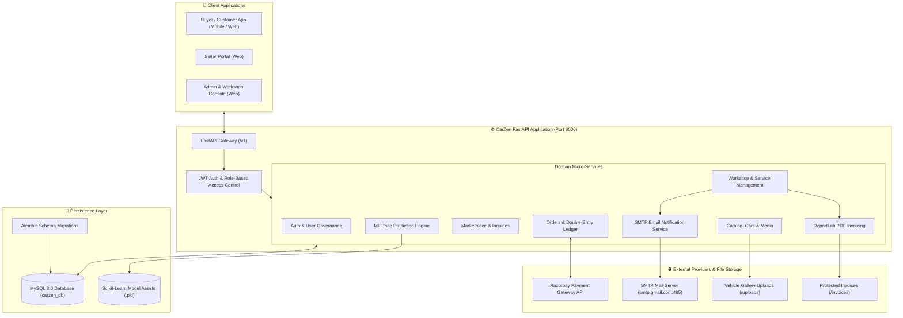
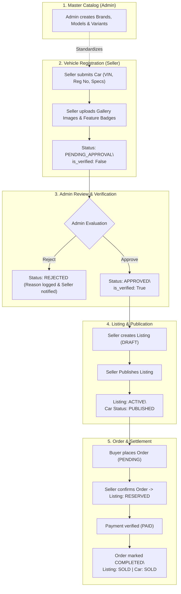
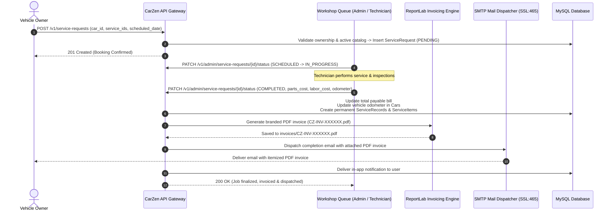

# CarZen - Automotive Marketplace, Workshop & Invoicing Ecosystem

[](https://fastapi.tiangolo.com)
[](https://www.python.org/)
[](https://www.sqlalchemy.org/)
[](https://www.mysql.com/)
[](https://alembic.sqlalchemy.org/)
[](https://razorpay.com/)
[](https://www.reportlab.com/)
[](https://scikit-learn.org/)
[](LICENSE)

**CarZen** is an enterprise-grade automotive ecosystem combining a **peer-to-peer vehicle marketplace**, an **intelligent car inventory & catalog manager**, an **automated workshop service booking & queue management system**, **cryptographic Razorpay payments**, an **automated PDF invoice generator & email dispatcher**, and a **machine learning vehicle price valuation engine**.

Engineered with a clean, decoupled architecture using **FastAPI**, **SQLAlchemy 2.0**, and **MySQL**, CarZen provides **176 production-tested REST endpoints** designed for buyers, sellers, workshop technicians, and platform administrators.

---

## 📑 Quick Navigation & Documentation

- 📖 **[Full REST API Documentation (176 Endpoints)](docs/API_DOCUMENTATION.md)** — Complete endpoint reference with HTTP methods, paths, parameters, schemas, sample payloads, and cURL commands.
- 💳 **[Payment Integration & Testing Guide](docs/PAYMENT_INTEGRATION_AND_TESTING_GUIDE.md)** — Step-by-step Razorpay sandbox integration, signature verification, and webhook testing guide.
- ⚡ **Interactive Swagger UI**: [`http://localhost:8000/docs`](http://localhost:8000/docs) *(available when server is running)*
- 📚 **ReDoc Documentation**: [`http://localhost:8000/redoc`](http://localhost:8000/redoc)

---

## 🌟 Key Platform Modules & Features

### 1. 🚗 Vehicle Catalog & Inventory Management
- **Hierarchical Master Catalog**: Normalized taxonomy of `Brands` $\to$ `Models` $\to$ `Variants` with detailed specifications (fuel type, transmission, body type, engine capacity, horsepower, torque, seating capacity).
- **Seller Car Registry**: Register vehicles with VIN, registration number, mileage, ownership count (1st, 2nd, etc.), condition (`NEW` or `USED`), and state registration.
- **Resale Validation**: Enforces mandatory registration and ownership documentation for pre-owned vehicles.
- **Multi-Media Gallery**: Upload vehicle photos and videos, designate primary cover images, reorder gallery items, and safely prune media.
- **Dynamic Feature Badges**: Attach comfort, safety, entertainment, and performance features to cars.
- **Admin Verification Workflow**: Strict approval pipeline (`PENDING_APPROVAL` $\to$ `APPROVED` or `REJECTED`). Automatic un-verification and status reset if sensitive vehicle attributes (VIN, transmission, fuel, variant) are modified post-approval.

### 2. 🛒 Marketplace & Public Discovery
- **Public Vehicle Listings**: Explore active vehicles with real-time keyword search, brand/model filtering, fuel and transmission filters, price range sliders, mileage sorting, and pagination.
- **Vehicle Detail View**: High-resolution image carousels, full technical specs, seller profile, and verified owner ratings.
- **View Analytics**: Automatic recording of view counters and buyer discovery analytics (`ListingViews`).
- **Wishlist & Favorites**: Authenticated buyers can bookmark vehicles and receive automated alerts when listing status changes (e.g., price drops or vehicle sold).
- **Seller Listing Lifecycle**: Create draft listings, publish to live marketplace, pause/unpublish, and adjust asking prices.

### 3. 💬 Inquiries & Buyer-Seller Negotiation
- **Direct Vehicle Inquiries**: Prospective buyers submit structured inquiries with customized offer prices, questions, and preferred contact channels.
- **Threaded Messaging**: Real-time two-way negotiation thread between buyer and seller per vehicle inquiry.
- **State Machine**: Track inquiries through `PENDING`, `RESPONDED`, `ACCEPTED`, `REJECTED`, and `CLOSED`.

### 4. 💳 Orders, Checkout & Razorpay Payments
- **Multi-Mode Order Support**: Full vehicle purchase orders or token/booking deposit reservations.
- **Server-Derived Pricing**: Zero client trust on amounts. The payment gateway amount is resolved directly from verified database records.
- **Razorpay Order Generation**: Secure order creation with configurable transaction safety caps (`RAZORPAY_MAX_ORDER_AMOUNT_PAISE`).
- **HMAC-SHA256 Signature Verification**: Cryptographic validation on the backend ensures tamper-proof checkout.
- **Cash on Delivery (COD)**: Offline cash settlement with formal seller/admin confirmation tracking.
- **Webhook Processing**: Asynchronous webhook handler (`/v1/payments/webhook`) for payment capture, authorization, and failure synchronization.
- **Double-Entry Financial Ledger**: Immutable audit log (`Transactions` table) tracking buyer, seller, order, amount, fee, and payment method.

### 5. 🔧 Digital Workshop, Automated Invoicing & Email Dispatch
- **Curated Service Catalog**: Standard periodic maintenance, repairs, brake overhauls, oil changes, and detailing packages with transparent pricing, duration, and warranty.
- **Multi-Service Selection**: Clients can bundle multiple services in a single request (`service_ids: [1, 2, 3]`), with automatic server-side aggregate computation.
- **Real-Time Slot Scheduling**: Conflict-free appointment slot booking with optional vehicle pickup and drop address linkage.
- **Workshop Queue Management**: Admins and technicians assign mechanics, transition job statuses (`PENDING` $\to$ `SCHEDULED` $\to$ `IN_PROGRESS` $\to$ `COMPLETED`), and record final odometer readings.
- **Dynamic Cost Calculation**:
  $$\text{Total Payable} = \text{Base Services Total} + \text{Replacement Parts Cost} + \text{Labor Cost}$$
- **Automated PDF Invoice Generation**:
  - Automatically compiles an itemized, branded service invoice PDF using **ReportLab** (`invoices/CZ-INV-XXXXXX.pdf`).
  - Stored securely in a private directory (outside public `/uploads`) to prevent URL snooping.
- **Automated SMTP Email Dispatch**:
  - Immediately upon job completion, sends a branded email to the vehicle owner with the PDF invoice attached via Python's `smtplib` and SSL.
  - Configurable via `SENDER_EMAIL` and `SENDER_PASSWORD`.
- **Permanent Digital Service Booklet**:
  - Automatically commits an immutable log to `ServiceRecords` and itemized lines to `ServiceItems`.
  - Automatically updates the vehicle's current odometer reading in `Cars`.
  - Accessible via `GET /v1/cars/{id}/service-history` to establish transparent maintenance provenance.

### 6. 🤖 Machine Learning Vehicle Price Valuation
- **Trained Scikit-Learn Model**: Built-in ML pipeline (`backend/model/car_price_model.pkl` & `feature_columns.pkl`).
- **Fair Market Value Estimation**: Predicts recommended listing price based on brand, model, manufacturing year, mileage, fuel type, transmission, and condition.

### 7. ⭐ Reviews, Safety & Notifications
- **Verified Purchase Reviews**: Only buyers with completed vehicle orders can submit star ratings (1–5) and reviews.
- **Dispute & Moderation Reports**: Users can flag suspicious listings or fraudulent activity for administrative review.
- **In-App Notification Engine**: Event-driven notifications for order status, inquiry replies, vehicle approvals, and service milestones.

### 8. 🛡️ Admin Central Command
- **Operational Metrics**: Revenue, active users, catalog volume, and workshop job throughput.
- **Listing & Vehicle Moderation**: Review submitted vehicles and listings with single-click approve, reject, or delist controls.
- **User Governance**: Audit user profiles, promote roles (`USER` $\leftrightarrow$ `ADMIN`), and adjust account statuses (`ACTIVE`, `INACTIVE`, `BLOCKED`).
- **Workshop Management**: Assign technicians, confirm cash payments, and manage catalog packages.

---

## 🏛️ System Architecture



---

## 📂 Project Directory Structure

```
CarZen/
├── backend/
│   ├── app/
│   │   ├── api/v1/                   # REST API Routers (176 endpoints)
│   │   │   ├── addresss/             # User address CRUD & default toggle
│   │   │   ├── admin/                # Admin management (cars, listings, orders, services)
│   │   │   ├── auth/                 # Authentication, JWT issue & validation
│   │   │   ├── buyer/                # Buyer dashboard, discovery, orders, inquiries
│   │   │   ├── car_management/       # Cars, brands, models, variants, marketplace
│   │   │   ├── contact/              # User emergency & primary contacts
│   │   │   ├── notification/         # In-app notifications & read markers
│   │   │   ├── order/                # Vehicle checkout & order states
│   │   │   ├── payment/              # Razorpay integration, verification, webhooks
│   │   │   ├── report/               # User reports & safety moderation
│   │   │   ├── reviews/              # Verified car reviews & ratings
│   │   │   ├── seller/               # Seller dashboard, inquiries, orders
│   │   │   ├── services/             # Workshop catalog, booking, digital logbook
│   │   │   ├── transactions/         # Financial audit ledger
│   │   │   ├── users/                # User profile & account management
│   │   │   └── home.py               # API health check endpoint
│   │   ├── core/                     # JWT tokens, password hashing & dependencies
│   │   ├── database/                 # SQLAlchemy engine, session & declarative base
│   │   ├── models/                   # SQLAlchemy ORM models & Enum definitions
│   │   ├── schemas/                  # Pydantic v2 validation & response schemas
│   │   ├── services/                 # Domain business logic
│   │   │   ├── address/              # Address services
│   │   │   ├── admin/                # Admin operations services
│   │   │   ├── auth/                 # Auth token & user creation services
│   │   │   ├── buyer/                # Buyer analytics & discovery services
│   │   │   ├── car/                  # Catalog, car inventory & ML price services
│   │   │   ├── contact/              # Contact services
│   │   │   ├── dashboard/            # Platform metric services
│   │   │   ├── mail/                 # SMTP email service (mail_service.py)
│   │   │   ├── notifications/        # Notification dispatcher
│   │   │   ├── orders/               # Order lifecycle manager
│   │   │   ├── payments/             # Razorpay payment verification & webhook logic
│   │   │   ├── reports/              # Moderation report service
│   │   │   ├── review/               # Review & rating services
│   │   │   ├── seller/               # Seller inventory & inquiry handlers
│   │   │   ├── services/             # Workshop booking, PDF invoice generator
│   │   │   ├── transaction/          # Ledger recording services
│   │   │   └── users/                # User management services
│   │   └── main.py                   # FastAPI initialization, CORS & static mounts
│   ├── alembic/                      # Database schema migration scripts
│   ├── model/                        # Machine learning model assets
│   │   ├── car_price_model.pkl       # Trained Scikit-Learn price regression model
│   │   ├── feature_columns.pkl       # Feature column transformer metadata
│   │   └── model_name.pkl            # Model identifier metadata
│   ├── scripts/                      # Operational & utility scripts
│   │   ├── build_docs.py             # Automated API documentation generator
│   │   └── migrate_car_management.py # Car catalog schema migration script
│   ├── uploads/                      # Public media uploads (car images, avatars)
│   ├── alembic.ini                   # Alembic configuration
│   ├── requirements.txt              # Production Python dependencies
│   ├── run.py                        # Server runner entrypoint
│   └── .env.example                  # Environment configuration template
├── docs/
│   ├── API_DOCUMENTATION.md          # Complete REST API reference (176 endpoints)
│   └── PAYMENT_INTEGRATION_AND_TESTING_GUIDE.md # Razorpay integration & webhook testing
├── invoices/                         # Generated service PDF invoices (CZ-INV-XXXXXX.pdf)
├── LICENSE                           # Project license (MIT)
└── README.md                         # Main repository guide (this file)
```

---

## 🛠️ Tech Stack & Production Dependencies

| Layer | Component | Version | Role / Purpose |
| :--- | :--- | :--- | :--- |
| **Framework** | [FastAPI](https://fastapi.tiangolo.com/) | `0.141.1` | High-throughput asynchronous REST API framework |
| **ASGI Server** | [Uvicorn](https://www.uvicorn.org/) | `0.52.3` | ASGI web server with auto-reloading |
| **ORM** | [SQLAlchemy](https://www.sqlalchemy.org/) | `2.0.52` | Python SQL toolkit and Object Relational Mapper |
| **Database Driver** | [PyMySQL](https://github.com/PyMySQL/PyMySQL) | `1.2.0` | Pure-Python MySQL client driver |
| **Migrations** | [Alembic](https://alembic.sqlalchemy.org/) | `1.16.5` | Lightweight database schema migration engine |
| **Validation** | [Pydantic](https://docs.pydantic.dev/) v2 | `2.15.0` | Data parsing, validation, and schema generation |
| **Security & JWT** | `python-jose` + `passlib` | `3.5.0` / `1.7.4` | JWT token encoding/decoding and bcrypt password hashing |
| **Payments** | `Razorpay REST API` | — | Payment order generation & HMAC-SHA256 signature verification |
| **Invoicing** | [ReportLab](https://www.reportlab.com/) | `5.0.1` | Automated PDF document generation for workshop invoices |
| **Email Dispatch** | `smtplib` + `email.message` | Standard Lib | SSL SMTP email delivery with binary attachments |
| **Machine Learning**| `scikit-learn` / `joblib` | — | Used car price valuation model inference |
| **HTTP Client** | [HTTPX](https://www.python-httpx.org/) | `0.28.1` | Asynchronous HTTP client for Razorpay API calls & tests |
| **File Handling** | `python-multipart` | `>=0.0.20` | Multipart form-data parser for car image uploads |

---

## 🚀 Getting Started & Installation

### Prerequisites
Make sure you have installed:
- **Python 3.10+** (Python 3.12 recommended)
- **MySQL 8.0+** running locally or accessible remotely
- **Git**

---

### Step 1: Clone the Repository
```bash
git clone https://github.com/your-org/CarZen.git
cd CarZen
```

---

### Step 2: Set Up Virtual Environment
```bash
# Windows (PowerShell)
python -m venv venv
.\venv\Scripts\Activate.ps1

# Linux / macOS
python3 -m venv venv
source venv/bin/activate
```

---

### Step 3: Install Dependencies
```bash
pip install --upgrade pip
pip install -r backend/requirements.txt
```

---

### Step 4: Configure Environment Variables
Create your local `.env` file in the `backend/` directory by copying the example:

```bash
cp backend/.env.example backend/.env
```

Configure your environment settings in `backend/.env`:

```ini
# Database Connection
DATABASE_HOST="localhost"
DATABASE_PORT=3306
DATABASE_NAME="carzen_db"
DATABASE_USER="root"
DATABASE_PASSWORD="your_mysql_password"

# Allowed CORS Origins (Comma-separated)
CORS_ORIGINS="http://localhost:3000,http://127.0.0.1:8000,http://localhost:8000"

# JWT Security
SECRET_KEY="your-super-secret-jwt-key-replace-in-production"
ALGORITHM="HS256"
ACCESS_TOKEN_EXPIRE_MINUTES=1440

# Razorpay Payment Gateway
RAZORPAY_KEY_ID="rzp_test_your_key_id"
RAZORPAY_KEY_SECRET="your_razorpay_secret"
RAZORPAY_WEBHOOK_SECRET="your_razorpay_webhook_secret"
RAZORPAY_MAX_ORDER_AMOUNT_PAISE=5000000

# Automated Email Dispatcher (Gmail SMTP or Custom SMTP)
SENDER_EMAIL="your-service-email@gmail.com"
SENDER_PASSWORD="your-app-specific-password"
```

---

### Step 5: Database Setup
1. **Create MySQL Database**:
   ```sql
   CREATE DATABASE carzen_db CHARACTER SET utf8mb4 COLLATE utf8mb4_unicode_ci;
   ```

2. **Initialize Tables**:
   Tables are automatically verified and created by SQLAlchemy during the application lifespan startup. To run migrations via Alembic:
   ```bash
   cd backend
   alembic upgrade head
   cd ..
   ```

---

### Step 6: Start the Application Server

Run from repository root:
```bash
python backend/run.py
```
Or start directly with Uvicorn:
```bash
uvicorn app.main:app --app-dir backend --reload --host 0.0.0.0 --port 8000
```

The application will be live at:
- **API Base URL**: `http://localhost:8000`
- **Interactive Swagger Docs**: `http://localhost:8000/docs`
- **ReDoc Documentation**: `http://localhost:8000/redoc`

---

## 🔄 Core Business Workflows

### 1. Car Onboarding, Approval & Marketplace Lifecycle



### 2. Workshop Servicing, PDF Invoicing & Email Dispatch



---

## 🔒 Authentication & Role-Based Access Control (RBAC)

CarZen uses OAuth2 Bearer Tokens (JWT).

### Roles Matrix
| Role | Code Value | Permissions |
| :--- | :--- | :--- |
| **Public** | `None` | View active marketplace listings, read reviews, browse service catalog, health checks, webhooks. |
| **User (Buyer & Seller)** | `user` | Register vehicles, upload media, create listings, negotiate inquiries, place orders, book workshop services, submit reviews. |
| **Admin** | `admin` | Verify vehicles, moderate listings, manage catalog taxonomy, assign workshop technicians, inspect financial transactions, govern user accounts. |

### Authentication Flow
1. **Register**: `POST /v1/auth/register` creates a user account.
2. **Login**: `POST /v1/auth/login` verifies credentials and returns a signed JWT.
3. **Attach Header**: Send `Authorization: Bearer <access_token>` with protected requests.
4. **Session Verification**: `GET /v1/auth/validate` validates token liveness and retrieves the user profile.

---

## 📋 API Overview Quick Reference (176 Endpoints)

For complete schemas, request/response bodies, and cURL commands, see **[docs/API_DOCUMENTATION.md](docs/API_DOCUMENTATION.md)**.

| Category | Endpoints | Key Operations |
| :--- | :---: | :--- |
| **System & Health** | `1` | Health check probe (`GET /`). |
| **Authentication & Auth** | `4` | Registration, login, session validation, admin registration. |
| **User Profile & Management**| `10` | Profile retrieve/update, password change, admin user governance. |
| **Address Management** | `5` | CRUD for billing, shipping, and service pickup addresses. |
| **Contact Information** | `6` | Emergency and primary contact information CRUD. |
| **Vehicle Catalog Taxonomy**| `19` | Hierarchical Brands, Models, and Variants with normalized specs. |
| **Seller Car Inventory** | `17` | Add cars, upload gallery media, feature badges, view stats. |
| **Marketplace Listings** | `8` | Public vehicle search, multi-filters, publish/unpublish listings. |
| **Favorites & Wishlist** | `3` | Save/unsave vehicles, fetch bookmarked favorites. |
| **Buyer Operations** | `11` | Buyer dashboard, discovery analytics, inquiry tracking, purchase orders. |
| **Seller Operations** | `9` | Seller dashboard, manage received inquiries and inbound orders. |
| **Inquiry Messaging** | `2` | Real-time negotiation messaging threads. |
| **Vehicle Orders & Checkout**| `3` | Create vehicle orders, cancel orders, inspect details. |
| **Payments & Razorpay** | `6` | Create Razorpay orders, HMAC signature verify, cash settlement, webhook. |
| **Financial Ledger** | `4` | Double-entry transaction audit records for buyers, sellers, admins. |
| **Workshop & Service Center**| `16` | Multi-service booking, slot availability, digital service logbook, online & cash payments. |
| **Reviews & Ratings** | `5` | Verified buyer review submissions, car rating aggregates. |
| **Moderation Reports** | `3` | Report suspicious listings or fraudulent accounts. |
| **Notifications System** | `5` | In-app notification feed, unread counters, mark-as-read. |
| **Admin Operations** | `39` | Approve/reject cars, moderate listings, workshop queue, assign technicians, finalize service bills, inspect ledger. |

---

## 🔄 Automated API Documentation Generator

CarZen includes a built-in documentation generator that introspects the live FastAPI schema and produces complete, up-to-date markdown documentation with realistic sample payloads and cURL commands:

```bash
python backend/scripts/build_docs.py
```

This updates **`docs/API_DOCUMENTATION.md`** with all 176 endpoints, request/response models, and architecture guides.

---

## 🧪 Testing & Code Quality

Run the test suite:
```bash
pytest backend/tests/
```

Run code quality and style checks:
```bash
ruff check backend/
```

---

## 📄 License

This project is licensed under the MIT License — see the [LICENSE](LICENSE) file for details.
